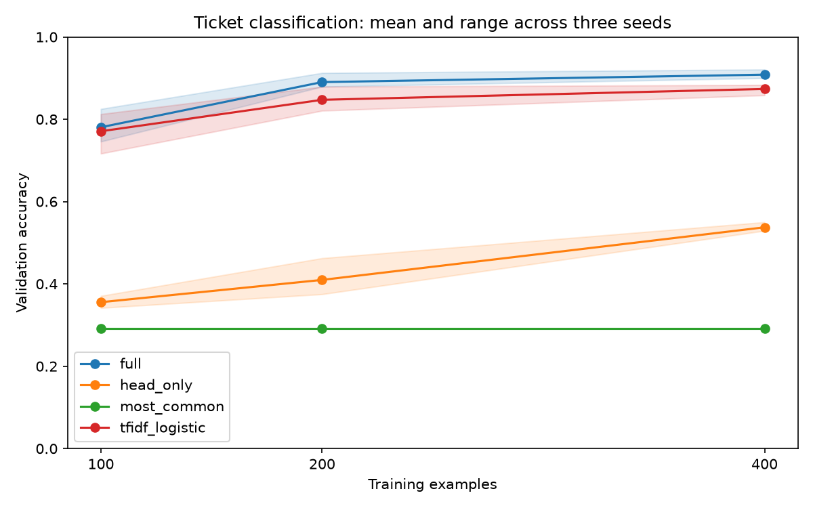

# Lakeshore Ticket Sorter: fine-tuning against a baseline

Model: [Lakeshore Ticket DistilBERT](https://huggingface.co/whois-tc/lakeshore-ticket-distilbert)  
Space: [Lakeshore Ticket Sorter](https://huggingface.co/spaces/whois-tc/lakeshore-ticket-sorter)

## What it does

This project predicts which queue should receive a fictional Lakeshore Bike Share support ticket: `billing`, `bike_fault`, `station`, or `account`. It compares two DistilBERT training approaches with two simpler baselines.

## How to run it

From the repository root:

```bash
conda env create -f environment.yml
conda activate lab09-fine-tune-and-publish
python run_experiments.py
python app.py
```

The experiment command reruns the validation grid, writes the reports, and saves the selected model in `model/`. Git ignores that directory because the weights are published separately. The local app uses those saved weights. To rerun only the final evaluation using the existing validation logs, use `python run_experiments.py --final-only`.

## Data and split

The supplied `tickets_data.py` generates 1,200 invented support tickets. A fixed stratified 60/20/20 split gives 720 training, 240 validation, and 240 test tickets. The split seed is 2026. All methods use the same stratified training sample for a given size and seed. The test tickets are held out from model selection.

## Methods

The baselines are the most common training label and TF-IDF with logistic regression. The DistilBERT variants either freeze the pretrained backbone and train only the classification head, or update the full model.

The grid uses 100, 200, and 400 training tickets with seeds 2026, 2027, and 2028. Both DistilBERT modes use AdamW, a fixed learning rate of `5e-5`, batches of 16, and up to three epochs. Three epochs were selected for both modes based on mean validation accuracy at 400 tickets. Full fine-tuning won the validation comparison. For final evaluation, it and both baselines used the same 400-ticket sample at seed 2026.

## Results

Mean validation accuracy across three seeds, with the minimum and maximum in parentheses:

| Training tickets | Most common | TF-IDF + logistic regression | Head only | Full DistilBERT |
|---:|---:|---:|---:|---:|
| 100 | 29.17% | 77.08% (71.67–81.25%) | 35.56% (34.17–37.08%) | 78.06% (74.58–82.50%) |
| 200 | 29.17% | 84.72% (82.08–87.92%) | 40.97% (37.50–46.25%) | 89.03% (87.92–91.25%) |
| 400 | 29.17% | 87.36% (85.83–88.33%) | 53.75% (52.92–55.00%) | 90.83% (90.00–92.08%) |

The most-common baseline scored 29.17% in every validation run.



Final results on the 240 held-out test tickets:

| Method | Accuracy | Macro F1 |
|---|---:|---:|
| Most common label | 28.75% | 0.1117 |
| TF-IDF + logistic regression | 84.58% | 0.8450 |
| Full DistilBERT | 90.00% | 0.9007 |

See the [test confusion matrix](reports/confusion_matrix.png), [run-by-run results](reports/results.csv), and [written analysis](REPORT.md).

## Your own 40 messages

The current supplementary check uses 40 AI-written fictional tickets, 10 per queue, separate from training and model selection. TF-IDF and full DistilBERT each classified 34 of 40 correctly. Macro F1 was 0.8527 for TF-IDF and 0.8445 for DistilBERT. This is an AI-written check, not an author-written or real-customer evaluation.

## Publishing

`python share.py` generates the model card from the test results. With Hugging Face authentication configured and the public Gradio Space already created on ZeroGPU, `python publish.py` uploads the model and app. The hosted app loads the published model; the local app loads `model/`. No token belongs in the repository.

## Tests

```bash
python -m ruff format --check .
python -m ruff check .
python -m pytest
```

The suite checks the split and sampling, the baselines, token truncation and label preservation, frozen and trainable weights, repeatability, tiny-batch learning, saved-model reload, model-card headings, and app behaviour.

## Limitations

The tickets are invented, and even the held-out generator tickets may share writing patterns with training examples. The separate 40-ticket check is small. The demo shows model scores, not guarantees, and should not route real customer tickets without validation on real data and human review.